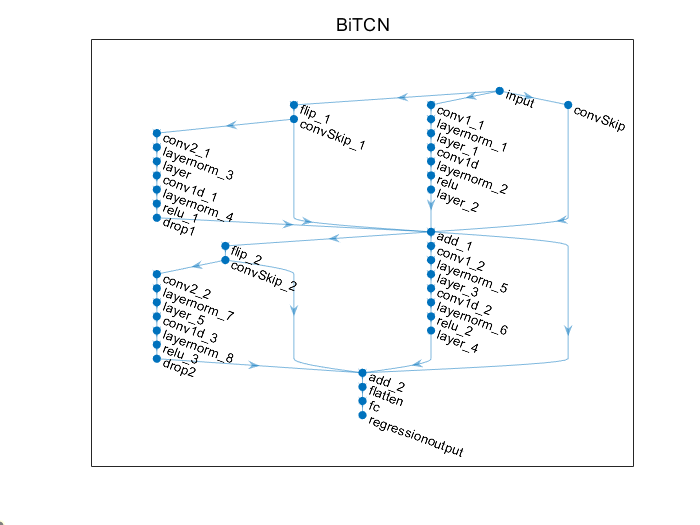
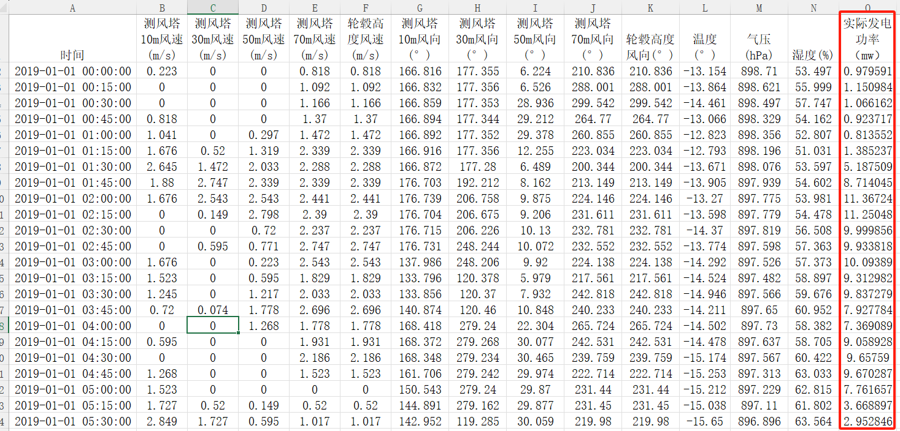
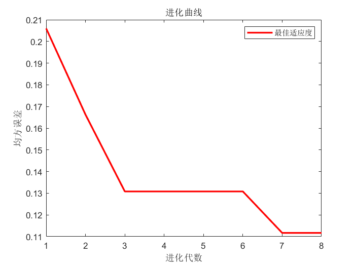
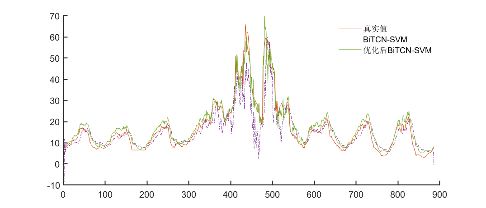
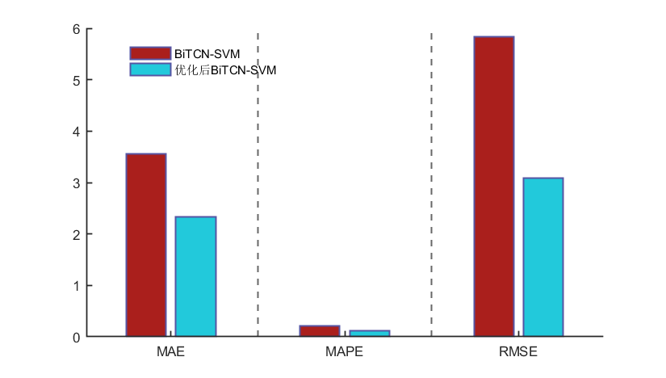
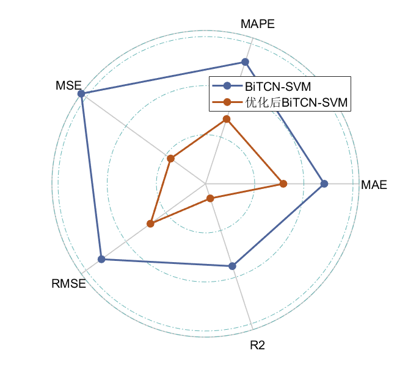
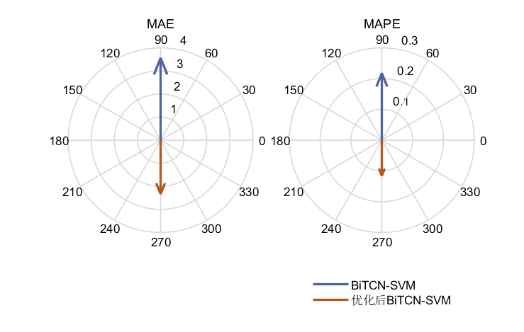
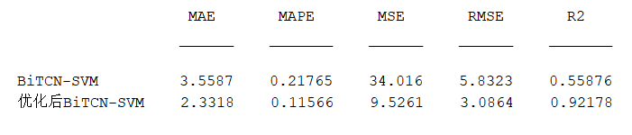
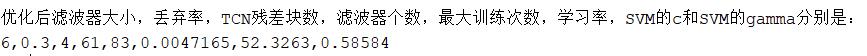

# Mini-Innovation Model! 6 Algorithm Optimizations for BiTCN-SVM Single-Variable Input Single-Step Prediction in 2024

The current code mainly features the following: It employs six new algorithms for 2024 to optimize eight parameters of the BiTCN-SVM model, including filter size, dropout rate, number of TCN residual blocks, number of filters, maximum training iterations, learning rate, and SVM's c and gamma. The results before and after optimization are compared.
The six algorithms are as follows: Alpha Evolution Algorithm (ALPHA), Cooperative Group Optimization Algorithm (SSOA), Seashell Algorithm (FATA), Escape Optimization Algorithm (ESC), Vector Weighted Average Optimization Algorithm (INFO), and Information Acquisition Optimizer (IAO).
The code allows for the switching between these six algorithms! It can also be combined with other improved intelligent algorithms introduced.
Learning how to call these algorithms will allow you to replace them with others at will! The code is set up as follows:
% Optional: 'FATA','AE','ESC','INFO','SSOA','SCSO','SSA','IAO';\n​\n[Best_score, Best_pos, curve] = FATA(popsize, maxgen, lb, ub, dim, fobj); % Modify the function name here\nBiTCN-SVM model  
BiTCN can extract features from time series data, identifying long-term dependencies in the data. After processing the data with BiTCN, the features are fed into an SVM for fitting, fully leveraging the strengths of each model to enhance prediction accuracy.
The specific approach involves feeding the preprocessed training set through the BiTCN model and then extracting the features from the last fully connected layer of the BiTCN model. These features are then fed into an SVM for fitting, enhancing the generalization capability of the model.
Building the BiTCN network model
\n        \n  
Data preparation  
Datasets are uniformly based on the wind power generation power data from a certain area in Xinjiang mentioned earlier, but this time only using the column of power generation.
The data processing method is not difficult either. First, extract this column of data, then use the previous several time points as model inputs and the power at one future moment as outputs. Repeat this process to select a large number of samples. Then, divide the training set and test set is all good.
It's also easy to replace the data. The code has already written the numbers for the steps and the predicted number into variables, just change the number directly.
To demonstrate the optimization of eight parameters in the Escape Optimization Algorithm on the BiTCN-SVM model:
\n        \n      \n        \n      \n        \n      \n        \n      \n        \n      \n        \n      \n        \n  
You can see that after optimization, the prediction accuracy of BiTCN-SVM has greatly improved!
This algorithm has been integrated into the machine learning prediction family kit, those who need it can jump to the link to get it:

## Images

<!-- PAYMENT_BLOCK -->

## Get this dataset

- Payment link (Stripe): [Buy now](https://buy.stripe.com/3cs8yP7sY87d0vu9AB)
- Payment QR code: 

<!-- /PAYMENT_BLOCK -->
